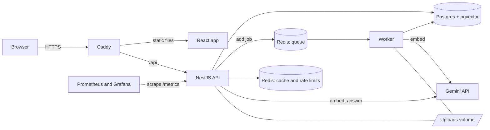
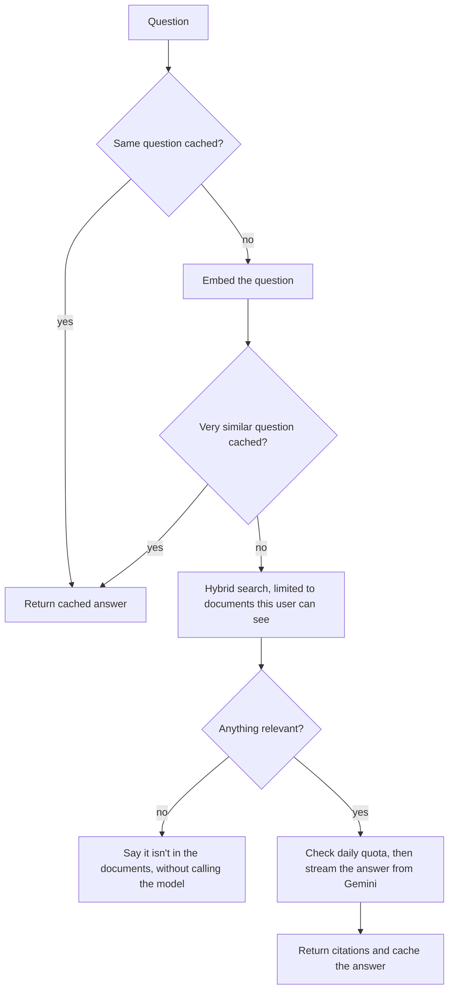

# Citewise

Ask your documents questions and get answers that cite the exact page. You upload PDFs and text files, and every answer links back to the passage it came from, so you can check it instead of trusting it.

I built this to learn backend engineering and deployment properly, so a lot of the interesting parts are behind the scenes: a job queue, hybrid search, rate limits, and an evaluation suite that measures whether search actually works.

## What it does

- Sign up with email and password, or continue with Google
- Upload PDF and text files, which a background worker extracts, chunks and embeds
- Ask a question and watch the answer stream in, with citations that open the highlighted passage
- If your documents don't cover a question, it says so instead of making something up
- Read from your own private documents plus a shared public library of engineering notes

## Architecture



**Uploading.** The API checks the file's actual bytes, saves it, and queues a job, which takes about 90 ms. A separate worker then extracts text page by page, splits it into overlapping chunks and embeds them. Jobs can safely run twice, and a retry resumes where it stopped so it doesn't spend quota again.

**Asking.**



## Known limits

- Scanned PDFs aren't supported, because there's no OCR.
- Each question stands alone, with no follow-ups.
- Login tokens live in `sessionStorage`. A strict content security policy reduces the risk, but httpOnly cookies would be better, and tokens can't be revoked before they expire.
- Password signups don't verify email, and registering reveals whether an email is taken.
- A document can get stuck on "processing" if Redis loses its data, until it's uploaded again.
- Free-tier Gemini may use submitted text to improve Google's products, which is why the app warns against uploading anything sensitive.

## Run it locally

You need Node 24, Docker and a free [Gemini API key](https://aistudio.google.com/apikey). To try it without a key, set `AI_PROVIDER=fake`, which gives placeholder results.

```bash
cp .env.example .env    # then set JWT_SECRET and GEMINI_API_KEY
npm install
npm --prefix frontend install
docker compose up -d
npm run migration:run
npm run dev             # API, worker and frontend together
npm run seed            # optional: adds the public engineering notes
```

- App: http://localhost:5173
- API docs: http://localhost:4000/docs
- Health check: http://localhost:4000/health

Google sign-in is optional. Create an OAuth client ID in Google Cloud with `http://localhost` and `http://localhost:5173` as JavaScript origins, then set `GOOGLE_CLIENT_ID`.

On Windows PowerShell, use `npm.cmd` if execution policy blocks `npm.ps1`.
After changing `.env`, stop the running app and run `npm.cmd run dev` again.
The landing page is shown when signed out; sign in to open the document workspace.
For a configured Google client, **Continue with Google** works for both new and existing accounts.
Use a Web application OAuth client and add the full origin, including the scheme and port.
For the planned live site, the origin is `https://citewise.callangonsalves.tech`.
Only the client ID is needed; this flow does not use a client secret.

Documents uploaded before search existed can be indexed with `npm run reindex`.

## Tests and evaluation

```bash
npm test                  # unit tests
npm run test:e2e          # full app against real Postgres and Redis, with fake AI
npm run build
DATABASE_NAME=docintel_eval npm run eval               # search quality
DATABASE_NAME=docintel_eval npm run eval -- --answers  # also calls the model
```

The evaluation needs a Gemini key and a migrated `docintel_eval` database.

## More

- [API examples](docs/API.md)
- [Deploying to a server](docs/DEPLOYMENT.md)

## Stack

NestJS, TypeScript, PostgreSQL, pgvector, Redis, BullMQ, TypeORM, Gemini, React, Vite, Tailwind, Docker, Caddy, Prometheus, Grafana and GitHub Actions.
