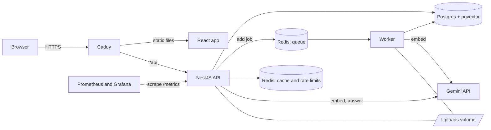
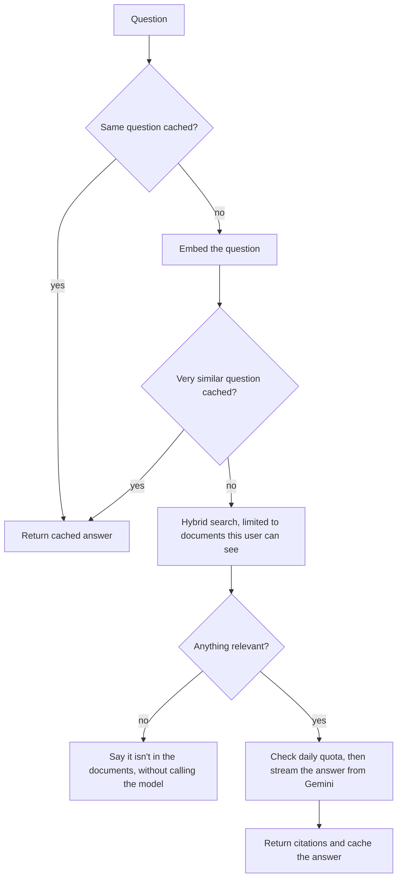

# Citewise

Ask your documents questions and get answers that cite the exact page. You upload PDFs and text files, and every answer links back to the passage it came from, so you can check it instead of trusting it.

I built this to learn backend engineering and deployment properly, so a lot of the interesting parts are behind the scenes: a job queue, hybrid search, rate limits, and an evaluation suite that measures whether search actually works.

## What it does

- Sign up with email and password, or continue with Google
- Upload PDF and text files, which a background worker extracts, chunks and embeds
- Ask a question and watch the answer stream in, with citations that open the highlighted passage
- If your documents don't cover a question, it says so instead of making something up
- Read from your own private documents plus a shared public library of engineering notes

## Architecture



**Uploading.** The API checks the file's actual bytes, saves it, and queues a job, which takes about 90 ms. A separate worker then extracts text page by page, splits it into overlapping chunks and embeds them. Jobs can safely run twice, and a retry resumes where it stopped so it doesn't spend quota again.

**Asking.**



## How well it works

I measure search on a fixed set of 30 questions, mostly worded differently from the notes, plus 8 the notes can't answer. `eval/results.json` has the full output.

| Method | Right passage first | Right passage in top 5 | MRR |
|---|---|---|---|
| Keywords only | 83.3% | 96.7% | 0.894 |
| Vectors only | 80.0% | 100% | 0.900 |
| **Hybrid (what the app uses)** | **90.0%** | 96.7% | **0.933** |

With the relevance cutoff on, all 8 off-topic questions were blocked before reaching the model, and all 30 real ones kept their passage. With the real model, all 30 answers contained the expected term and a citation, and all 8 off-topic questions were refused.

Please read those as a smoke test rather than a benchmark. The corpus is only 17 chunks, and I wrote both the notes and the questions. The answer check just looks for an expected term, and hybrid search still misses one passage that vector search alone finds.

The evaluation did change the code. My first version of hybrid search scored the same as vectors alone, and keyword search only found 23% of passages, because it required every word of a question to match. Fixing that let off-topic questions through on a single shared word, so keyword matches now only count alongside a relevant vector match or when every word matches.

## Decisions I can explain

- **pgvector instead of a vector database.** Everything stays in one transactional store, and access rules are a normal SQL filter.
- **Access rules inside the SQL.** Filtering in code afterwards would let someone else's private text pass through the system.
- **A strict semantic cache (0.93).** I measured that "advantages of paging" and "disadvantages of paging" score 0.88, higher than two real rewordings at 0.78. A loose threshold would confidently return the wrong answer, so I accept fewer cache hits.
- **Cache keys include a fingerprint of the user's documents.** Answers can't leak between users, and adding or deleting a document makes old answers unreachable without any invalidation code.
- **Two Redis instances.** The cache may evict keys when full, but queued jobs must never disappear.
- **Quotas in Postgres, rate limits in Redis.** A rate limit that resets during an outage is fine. A daily spending limit shouldn't be.
- **Linking Google removes the old password.** Password signups aren't email-verified, so someone could register with your address first and wait for you to link your account.

## Known limits

- Scanned PDFs aren't supported, because there's no OCR.
- Each question stands alone, with no follow-ups.
- Login tokens live in `sessionStorage`. A strict content security policy reduces the risk, but httpOnly cookies would be better, and tokens can't be revoked before they expire.
- Password signups don't verify email, and registering reveals whether an email is taken.
- A document can get stuck on "processing" if Redis loses its data, until it's uploaded again.
- Free-tier Gemini may use submitted text to improve Google's products, which is why the app warns against uploading anything sensitive.

## Run it locally

You need Node 24, Docker and a free [Gemini API key](https://aistudio.google.com/apikey). To try it without a key, set `AI_PROVIDER=fake`, which gives placeholder results.

```bash
cp .env.example .env    # then set JWT_SECRET and GEMINI_API_KEY
npm install
npm --prefix frontend install
docker compose up -d
npm run migration:run
npm run dev             # API, worker and frontend together
npm run seed            # optional: adds the public engineering notes
```

- App: http://localhost:5173
- API docs: http://localhost:4000/docs
- Health check: http://localhost:4000/health

Google sign-in is optional. Create an OAuth client ID in Google Cloud with `http://localhost` and `http://localhost:5173` as JavaScript origins, then set `GOOGLE_CLIENT_ID`.

Documents uploaded before search existed can be indexed with `npm run reindex`.

## Tests and evaluation

```bash
npm test                  # unit tests
npm run test:e2e          # full app against real Postgres and Redis, with fake AI
npm run build
DATABASE_NAME=docintel_eval npm run eval               # search quality
DATABASE_NAME=docintel_eval npm run eval -- --answers  # also calls the model
```

The evaluation needs a Gemini key and a migrated `docintel_eval` database.

## More

- [API examples](docs/API.md)
- [Deploying to a server](docs/DEPLOYMENT.md)

## Stack

NestJS, TypeScript, PostgreSQL, pgvector, Redis, BullMQ, TypeORM, Gemini, React, Vite, Tailwind, Docker, Caddy, Prometheus, Grafana and GitHub Actions.
